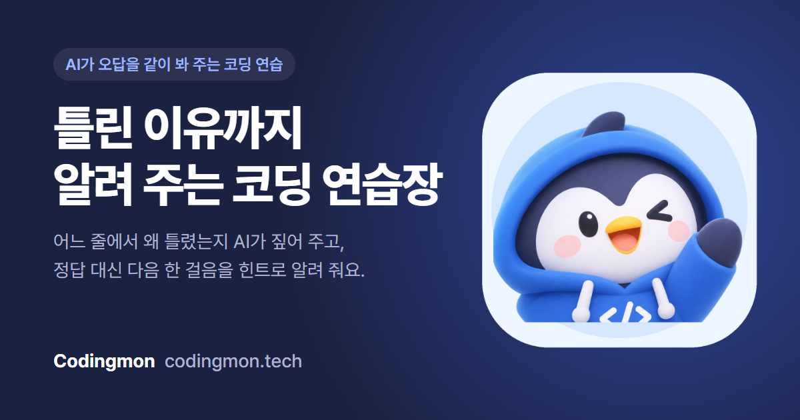
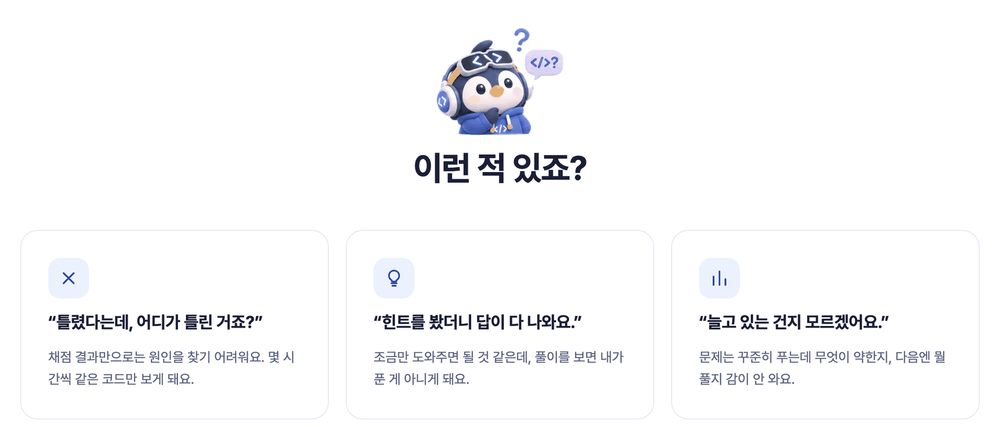
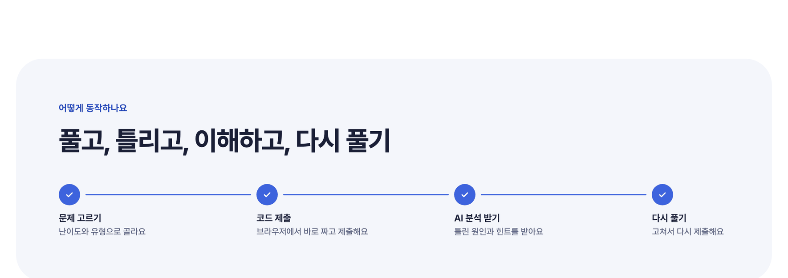
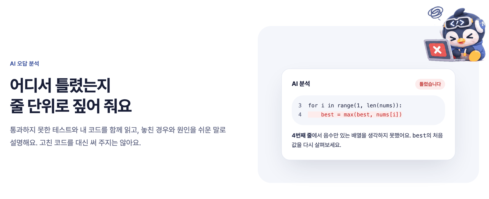
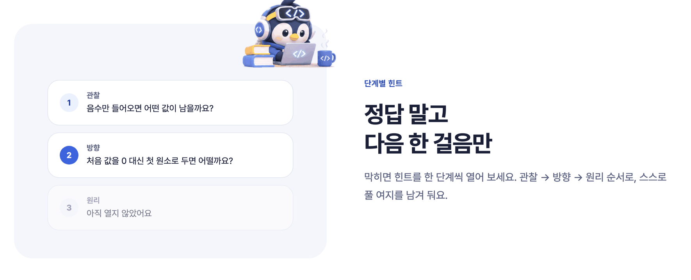
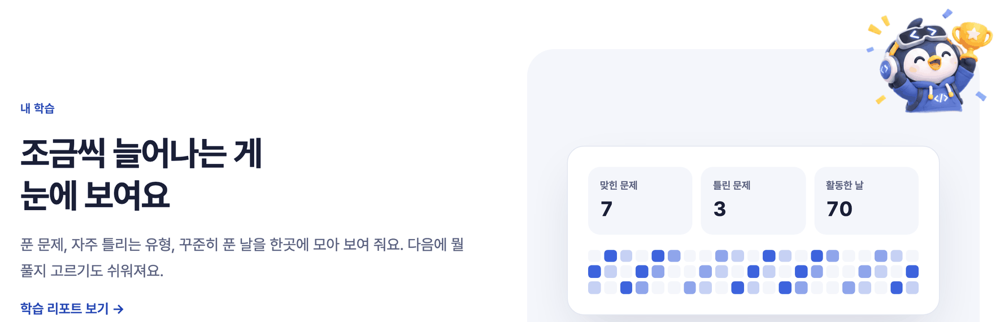
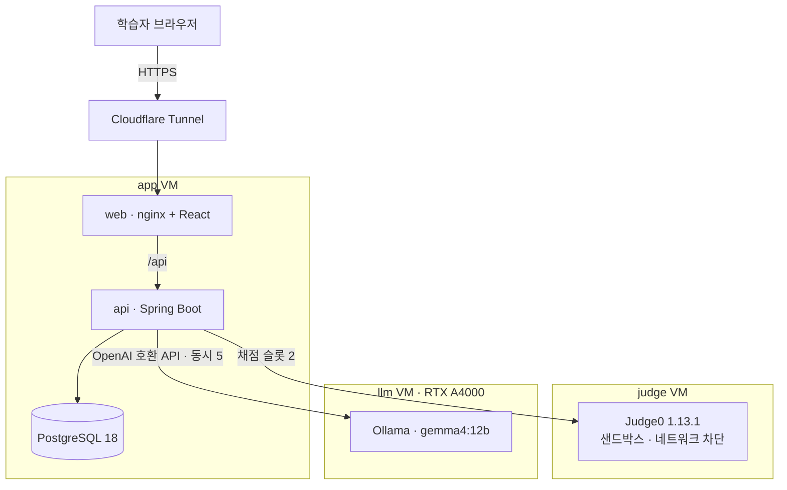
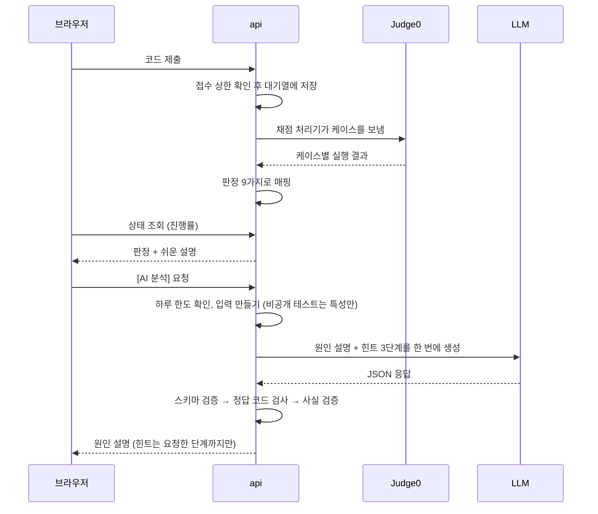

<div align="center">



# Codingmon

**채점 근거를 활용한 AI 오답 분석 기반 코딩테스트 학습 플랫폼**

틀린 이유를 근거를 들어 설명하고, 정답 코드는 주지 않는다.

[서비스 바로가기](https://codingmon.tech) · [기능명세서](docs/feature-spec.md) · [AI 기능 정의](docs/AI_FEATURES.md) · [API 명세](contracts/openapi.yaml) · [협업 규칙](docs/collaboration.md)


</div>

> 한 학기 졸업작품으로 만들고 있다 (2026.09.28 ~ 12.06). 서비스는 [codingmon.tech](https://codingmon.tech)에서 운영 중이다.

## 목차

- [왜 만들었나](#왜-만들었나)
- [핵심 기능](#핵심-기능)
- [시스템 아키텍처](#시스템-아키텍처)
- [기술적 도전](#기술적-도전)
- [기술 스택](#기술-스택)
- [폴더 구조](#폴더-구조)
- [로컬에서 실행하기](#로컬에서-실행하기)
- [협업 방식](#협업-방식)
- [일정](#일정)
- [팀원](#팀원)

## 왜 만들었나

코딩테스트를 혼자 연습하면 두 가지 벽에 부딪힌다.

- 채점 사이트는 "틀렸습니다"만 알려 준다. 어느 입력에서 왜 틀렸는지 몰라 같은 코드만 몇 시간씩 보게 된다.
- AI 채팅에 물으면 고친 코드를 통째로 준다. 답은 맞지만 내가 푼 것이 아니다.



Codingmon은 그 사이를 노린다. 채점은 백준처럼 판정만 공개하고, 학습자가 원할 때 AI가 **채점 결과를 근거로** 틀린 이유를 짚는다. 정답 코드는 끝까지 주지 않는다.

| | 채점 사이트 | AI 채팅 | Codingmon |
|---|---|---|---|
| 틀린 이유 | 판정만 알려 줌 | 채점 결과를 모른 채 코드만 보고 짐작 | 판정, 예제 실행 결과, 비공개 테스트의 특성을 근거로 설명 |
| 도움을 받는 방식 | 없음 | 고친 코드를 바로 줌 | 관찰 → 방향 → 원리, 힌트를 한 단계씩 엶 |
| 다음에 풀 문제 | 직접 고름 | 없음 | 풀이 기록으로 약한 개념을 찾아 3문제 추천 |

## 핵심 기능

문제를 고르고, 브라우저에서 코드를 짜서 내고, 틀리면 AI 분석과 힌트를 받아 다시 푸는 흐름이다.



### 1. 백준과 같은 방식의 채점

- Python과 C++로 풀 수 있다. 공개 문제는 51개다(2026-11-23 기준).
- 제출하면 "기다리는 중 → 채점 준비 중 → 채점 중(진행률 %)"을 거쳐 백준과 같은 판정 9가지 중 하나가 나온다.
- 판정마다 쉬운 설명과 먼저 확인해 볼 점을 AI 없이 보여 준다. 예: 시간 초과면 "입력이 가장 클 때 반복이 몇 번 도는지 계산해 보세요."
- 비공개 테스트의 입력과 기대 출력은 공개하지 않는다. 공개 예제로 돌려 보는 [실행]은 시도 횟수에 넣지 않는다.

### 2. AI 오답 분석: 어디서 왜 틀렸는지 줄 단위로

정답이 아닌 판정을 받은 뒤 **[AI 분석]** 버튼을 누를 때만 AI가 개입한다.

- 원인 요약과 의심되는 줄 번호를 보여 준다.
- 근거를 둘로 나눈다. 실행으로 확인한 사실은 **[실행 결과]**, AI가 코드에서 짐작한 원인은 **[코드 분석]**으로 표시하고, 짐작은 단정하지 않는 말투로 쓴다.
- 판정별로 보는 곳이 다르다. 시간 초과면 입력 제한 대비 반복 횟수를, 출력 형식 오류면 줄 끝 공백과 빈 줄을 본다.



### 3. 단계별 힌트: 정답 말고 다음 한 걸음만

AI 분석 뒤 **[힌트 보기]**를 누를 때마다 한 단계씩 열린다.

| 단계 | 내용 |
|---|---|
| 1단계 관찰 | 무엇을 비교하거나 확인해 볼지. 실행 결과로 확인할 수 있는 사실에서 출발한다 |
| 2단계 방향 | "조건식", "반복 범위"처럼 고칠 위치와 방향만 |
| 3단계 원리 | 문제를 푸는 원리(수학적 규칙, 알고리즘 개념)를 식과 말로. 코드는 쓰지 않는다 |

힌트 세 단계는 분석할 때 함께 만들어 서버에 두고, 학습자가 연 단계까지만 내려보낸다. 몇 단계까지 열었는지는 학습 리포트 통계에 쓴다.



### 4. 맞힌 뒤에는 AI 코드 리뷰

정답을 받으면 **[AI 리뷰]**로 시간·공간 복잡도, 문제가 의도한 복잡도와의 비교, 개선점, 다음에 배울 개념을 받는다.

### 5. 학습 리포트와 다음 문제 추천

- 서로 다른 문제를 5개 이상 맞히면 하루 한 번 리포트를 만든다.
- 개념 태그마다 해결률, 평균 시도 횟수, 평균 힌트 단계를 계산해 취약 개념 2개를 고르고, 아직 못 푼 문제 3개를 추천한다.
- **추천은 서버의 규칙이 정하고, AI는 그 결과를 읽기 쉬운 설명으로 바꾸기만 한다.** AI는 추천 목록과 수치를 바꿀 수 없다.
- 연속 학습 일수, 잔디, 배지로 꾸준히 푼 기록을 보여 준다.



### 그 밖의 기능

- **처음 안내**: 가입하면 언어, 경험, 목표를 묻고 처음 풀 문제를 골라 준다.
- **로그인**: 이메일 가입과 GitHub 로그인
- **요금제**: 무료는 AI 분석·리뷰 하루 3회와 힌트 1단계까지, 프로(월 9,900원)는 하루 30회와 힌트 3단계까지다. 결제는 포트원 테스트 결제라 실제로 돈이 나가지 않는다.
- **관리자**: 문제 작성과 버전 관리, Python·C++ 정답 코드로 모든 케이스 검증, 공개 조건 확인(공개 예제 2개·비공개 5개 이상, 두 언어 정답 통과), 신고·회원 관리, 대시보드

## 시스템 아키텍처



- 팀 서버(Proxmox)에 VM 3대를 나눠 올렸다. 제출 코드를 실행하는 채점 VM에는 서비스 DB 자격 증명과 AI 키를 두지 않는다.
- 서버로 들어오는 포트를 열지 않는다. Cloudflare Tunnel이 바깥으로 나가는 연결로 웹을 공개한다.
- API 서버 하나 안에 API, 채점 처리기, AI 처리기, 리포트 계산이 패키지로 나뉘어 있다.
- 계획서의 AWS 3티어 배포는 마일스톤 ④에서 진행한다(#15).

### 제출부터 AI 분석까지



## 기술적 도전

### 1. AI가 정답 코드를 주지 않게 하려면?

프롬프트로 금지하는 것만으로는 지켜진다고 보장할 수 없다. 그래서 서버가 응답을 저장하기 전에 검사한다(`AnswerGuard`).

- 코드 블록, 들여 쓴 코드 줄, 함수 호출·반복문 머리 같은 코드 모양을 찾는다.
- 팀이 가진 검증 정답 코드와 8토큰 이상 이어서 같은 조각이 있는지 본다.
- 문제에 붙은 알고리즘 태그 이름(예: 동적 계획법, DP)을 먼저 말해 버리는지 본다. 지문에 이미 나온 이름은 괜찮다.
- 걸리면 어긴 규칙을 알려 주고 한 번 다시 만든다. 또 걸리면 결과를 보여 주지 않는다.

### 2. AI가 지어낸 근거를 사실처럼 말하지 않게 하려면?

응답을 [사실]과 [추정]으로 나눠 받고, 서버가 다시 확인한다(`FactCheck`).

- [사실] 항목은 모델이 받은 입력(판정, 예제 실행 결과, 컴파일 메시지, 비공개 테스트 요약)과 대조한다. 기댄 데가 없거나 어긋나면 [추정]으로 옮긴다.
- 제출 코드의 범위를 벗어난 줄 번호는 지운다.
- 학습 리포트도 같은 방식이다. AI 문장 속 수치를 서버 통계와 대조해 맞지 않는 문장을 지운다(`ReportNumberCheck`). 응답 스키마를 입력마다 만들어 모델이 추천 목록을 빼거나 늘리지 못하게 한다.

### 3. 비공개 테스트를 숨긴 채 근거 있게 설명하려면?

백준처럼 비공개 테스트의 입력과 기대 출력은 학습자에게 보여 주지 않는다. AI에게도 보내지 않는다.

- 대신 특성만 보낸다. 판정별 실패 수, 입력 크기 등급(작음·중간·큼)별 통과·실패 수, 가장 작은 입력과 가장 큰 입력에서 실패했는지다.
- 그래도 응답에 비공개 값 조각이 섞여 나오면 그 항목을 지우고, 요약이나 힌트에 있으면 결과를 막는다.

### 4. 남이 낸 코드를 안전하게 돌리려면?

Judge0 1.13.1을 이미지 digest까지 고정해 웹·API와 분리된 채점 VM에 띄웠다. 시간·메모리 제한과 컴파일 옵션은 API 서버가 정하고, 브라우저에서 온 값은 Judge0에 넘기지 않는다.

- **격리 검증**(#66, 2026-10-25 채점 VM): 네트워크 접근, 무한 반복, 4TB 메모리 요청, 깊이 10⁶ 재귀 같은 케이스를 돌려 실패 0건이었다. 무한 반복은 CPU 2.1초에 시간 초과로 끊겼고, 클라우드 메타데이터 주소도 샌드박스 안에서는 막혔다.
- **언어별 제한 실측**(#65): 입출력·정렬·딕셔너리처럼 입력이 큰 작업에서 Python은 C++보다 최대 2.7~5.3배 느렸다. 그래서 Python 제한을 C++ 제한 × 3 + 2초, 메모리 × 2로 정했다. 순수 반복은 100배 넘게 차이 나서 배수로 맞추지 않고, 문제를 등록할 때 Python 정답 코드로 시간을 재서 정한다.
- **접수 상한**: 미완료 제출은 사용자당 3개, 전체 100개까지만 받는다. 여러 연결에서 동시에 요청해도 PostgreSQL advisory lock으로 같은 상한을 지킨다.

### 5. AI가 느리거나 멈춰도 채점은 돌아가게 하려면?

2026-11-01부터 클라우드 AI API 대신 팀 서버의 오픈 웨이트 모델(`gemma4:12b`, Ollama, RTX A4000 16GB)을 쓴다.

- 호출당 요금이 없어 달러 예산 대신 동시 호출 수(5)와 대기열 크기로 모델 서버의 부담을 묶는다. 대기열이 차면 기다리게 하지 않고 바로 "혼잡"으로 답한다.
- AI 호출은 채점과 다른 스레드에서 돌고, 모델을 기다리는 동안 DB 연결을 쥐지 않는다. 모델이 응답하지 않아도 채점, 예제 실행, 제출 기록은 기다리지 않는다(`AiIsolationTest`).
- 응답은 JSON 스키마로 검증하고, 어기면 한 번만 다시 요청한다. 타임아웃에는 다시 부르지 않는다. 모델이 아직 만들고 있을 수 있어서다.

### 6. 동시에 100명이 쓰면 어디가 먼저 막힐까?

k6로 동시 사용자 N명이 문제를 풀어 제출하고 AI를 요청하게 해서 운영 서버에서 쟀다(2026-11-18, 채점 슬롯 2, AI 동시 처리 5).

| 동시 인원 | 10명 | 50명 | 100명 |
|---|---|---|---|
| 채점 대기 (중앙값 / 최대) | 5초 / 9초 | 41초 / 49초 | 52초 / 1분 58초 |
| AI 오답 분석 대기 (중앙값 / 최대) | 1분 50초 / 4분 4초 | 6분 31초 / 15분 9초 | 16분 48초 / 28분 12초 |
| API 응답 시간 (중앙값) | 1.7ms | 0.9ms | 0.9ms |
| HTTP 요청 실패 | 0 / 1,400 | 0 / 25,035 | 0 / 89,378 |

- 가장 먼저 막히는 곳은 GPU다. GPU 1장으로 분당 약 3.3건이 한계였다.
- 채점은 VM CPU가 남는데도 슬롯 수 때문에 밀렸다. 슬롯을 4로 늘리자 채점 대기가 1/2~1/3로 줄었고 판정이 달라진 제출은 없었다. 대신 채점 VM CPU가 거의 다 차서 운영에는 아직 적용하지 않았다.
- 전체 결과와 클라우드 비용 환산은 [`judge/bench/results/2026-11-18-load-test.md`](judge/bench/results/2026-11-18-load-test.md)에 있다.

## 기술 스택

| 분류 | 기술 |
|---|---|
| Frontend |         |
| Backend |       |
| 채점 |  Python 3.8.1, GCC 9.2.0 (C++17) |
| AI |   OpenAI 호환 API |
| Infra |     |
| 계약·테스트 |       |
| 결제 |  |

## 폴더 구조

| 폴더 | 내용 |
|---|---|
| `web/` | 프론트엔드 · React 19, Vite, TypeScript |
| `api/` | 백엔드 · Spring Boot 4, Java 21, PostgreSQL 18 |
| `judge/` | 채점 서버 · Judge0 자체 호스팅 설정, 실측·부하테스트 결과 |
| `infra/` | Docker Compose, 서버 배포, Cloudflare Tunnel, LLM 서버 설정 |
| `contracts/` | OpenAPI 명세 · 프론트엔드와 백엔드의 계약 |
| `docs/` | 설계 문서 · 기능명세서, AI 기능 정의, DB 스키마, 판정 매핑, 협업 규칙 |

문제 지문, 정답 코드, 비공개 테스트는 비공개 저장소 `problems`에 따로 둔다.

## 로컬에서 실행하기

화면만 볼 때는 백엔드 없이 MSW 가짜 응답으로 띄운다. Node.js 24 이상이 필요하다.

```bash
git clone https://github.com/codari-capstone/codingmon.git
cd codingmon/web
npm install
npm run dev:mock   # http://localhost:5173, 계정 user@codari.test / Codari!test1
```

백엔드까지 띄울 때는 폴더별 문서를 따른다.

| 띄울 것 | 문서 | 필요한 값 |
|---|---|---|
| API | [`api/README.md`](api/README.md) | `DB_URL`, `DB_USERNAME`, `DB_PASSWORD`, `JWT_SECRET`, `WEB_BASE_URL` |
| 채점 | [`judge/README.md`](judge/README.md) (맥은 "맥(Apple Silicon)에서 실행" 절) | `JUDGE0_URL`, `JUDGE0_AUTHN_TOKEN`. 비우면 제출이 대기 상태로 남는다 |
| AI | [`infra/README.md`](infra/README.md)의 "LLM 서버" | `LLM_URL`, `LLM_MODEL`. 비우면 AI만 장애로 응답하고 채점은 그대로 된다 |
| 서버 배포 | [`infra/README.md`](infra/README.md) | `infra/.env.example` 참고 |

## 협업 방식

- **명세 먼저**: API는 [`contracts/openapi.yaml`](contracts/openapi.yaml)을 먼저 쓴다. 백엔드는 그대로 구현하고, 프론트엔드는 같은 명세로 타입(`openapi-typescript`)과 가짜 API(MSW)를 만들어 동시에 개발한다.
- **이슈와 보드**: 모든 작업을 GitHub 이슈로 만들고 Projects 보드에서 진행 상황을 본다. 이슈는 기능명세서 ID(`LIST-01` 등)와 마일스톤에 연결한다.
- **PR**: 브랜치는 `feature/<이슈번호>-<설명>`, 제목은 `type(scope): 요약`이다. 팀원 1명이 승인하면 Squash로 병합하고, `contracts/`를 바꾸면 세 명이 모두 확인한다.

자세한 규칙은 [`docs/collaboration.md`](docs/collaboration.md)와 [조직 협업 규칙](https://github.com/codari-capstone/.github/blob/main/CONTRIBUTING.md)에 있다.

## 일정

| 마일스톤 | 기한 | 상태 |
|---|---|---|
| ① 제출 → 판정 · 쉬운 설명 | 4주차 (10/25) | 완료 |
| ② AI 분석 → 단계별 힌트 → 재제출 | 6주차 (11/8) | 완료 |
| ③ 학습 리포트 · 추천 포함 MVP 고정 | 7주차 (11/15) | 완료 |
| ④ AWS 배포 · 사용자 검증 | 9주차 (11/29) | 진행 중 |
| ⑤ 최종 발표 | 10주차 (12/6) | 예정 |

## 팀원

팀 **코다리**

| 김재환 | 강찬우 | 신정민 |
|:---:|:---:|:---:|
|  |  |  |
| 채점 · AI | 프론트엔드 | 백엔드 |
| [@jaehwan-space](https://github.com/jaehwan-space) | [@chanwoo3](https://github.com/chanwoo3) | [@jmin12663](https://github.com/jmin12663) |
